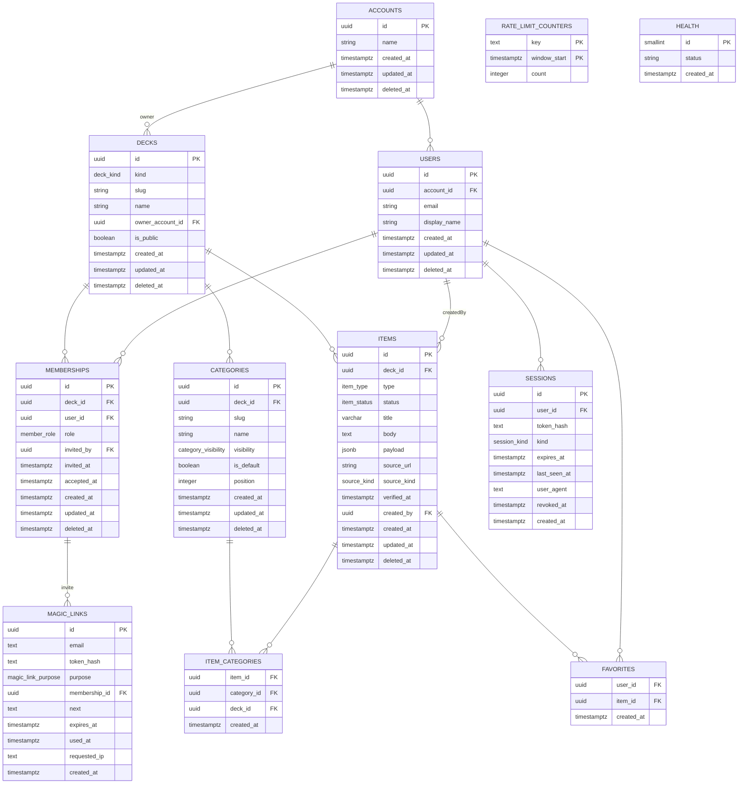

# Data model, invariants and migrations

_Overview: [architecture.md](../architecture.md). Decisions: [adr.md](../adr.md)._

## Data Model



### Key design patterns

- **Soft deletes**: All user-facing tables have `deleted_at` timestamp. Queries always filter `WHERE deleted_at IS NULL` unless explicitly archiving.
- **Denormalization**: `item_categories` includes `deck_id` to enable composite FK constraints without a separate join.
- **Unique constraints on slugs**: Partial unique indexes on slug + deck where `deleted_at IS NULL` prevent collisions among active records.
- **Timestamps with millisecond precision**: All `timestamptz` columns use `precision: 3` (JavaScript Date compatibility required for keyset cursors).
- **Invariant triggers**: Database enforces cross-table rules (default category protection, auto-creation, timestamps).

## Invariants

| Invariant | Description | Enforced by |
|-----------|-------------|------------|
| **Published item → ≥1 category** (master plan P1.2) | An item with status='published' must have at least one category. | Service only: `items.create()` (D6 assigns `general` when none given) and `items.update()` rejects a result that would be published with no categories. The master plan's "trigger later" is not scheduled yet. |
| **D5: item_categories dual FK** | Each item_category row references both item and category via composite FK, ensuring consistency. | Drizzle schema composite FK with ON DELETE CASCADE. |
| **D6: Empty categoryIds → default** | If item created with no categoryIds, automatically assign default category of deck. | Service `items.create()` after fetching default. |
| **D7: Default category auto-create + protect** | Every deck gets a 'general' default category on insert. Cannot be deleted or have is_default=false. | DB trigger `decks_create_default_category` (INSERT) + `categories_protect_default` (DELETE/UPDATE); unique index `categories_one_default_uq` ensures ≤1 default per deck. |
| **D3: Slugs** | `decks.slug` unique among live decks; `categories.slug` unique per deck. | Partial unique indexes `decks_slug_active_uq`, `categories_deck_slug_active_uq` (`WHERE deleted_at IS NULL`); 23505 → 409. |
| **D8: Body budget** | `body` ≤ `CARD_BODY_MAX` (600) Unicode code points. | zod `itemBodySchema` in @gobbit/shared; DB check constraint on `char_length(body)` (`0003_card_limits`). |
| **Personal deck (Phase 3B, supersedes D25's no-auto-deck)** | Each account has exactly one personal deck (`is_default`), ensured on every sign-in. It cannot be deleted, shared, re-slugged or made public; its address is `me`. | Partial unique index `decks_default_per_account_uq`; CHECKs `decks_default_is_personal`, `decks_slug_not_reserved`; trigger `decks_protect_default` (P0001 `default_deck_protected`). Service rules answer 409 `/problems/personal-deck`. |
| **Soft delete** (master plan P1.1, ADR-005) | Deleting sets `deleted_at` on accounts, users, decks, categories, items and memberships; queries exclude soft-deleted rows. Join tables (`item_categories`, `favorites`) are hard-deleted by design. | All repository `.find*()`, `.list()` include `WHERE isNull(t.deletedAt)`. Service `items.softDelete()`. |
| **Auto `updated_at`** (master plan P1.1) | Every update to accounts, users, decks, categories, items and memberships sets `updated_at = now()`. | DB trigger `<table>_set_updated_at` BEFORE UPDATE on each table. |
| **D9/D10: Payload budget and shape** | Each item type (text, link, image, table, calc) validates payload against a strict Zod schema. Payload ≤ 8192 UTF-8 bytes; DB enforces ≤ 9216 with a check constraint. | `payloadSchemaFor(type)` and the byte budget in @gobbit/shared (zod is authoritative); service calls `parse()` on PATCH; DB check constraint `items_payload_size_chk`. |
| **D12: Item type immutable** | Cannot PATCH an item's type. | Service `items.update()` rejects `'type' in patch` with 400. |
| **D13: Status default published** | Item created without a status defaults to 'published' and `verified_at = now()`. | Service `items.create()` sets both. `verified_at` is the publish time, not a review; the Reader shows "Added/Edited … ago" from `created_at`/`updated_at` instead (`lib/card-age.ts`). |
| **D14: Pagination keyset cursor** | Cursor encodes (createdAt, id) tuple, limiting result sets. Limit default 20, max 50; >50 rejects. | `limitSchema` in @gobbit/shared; `itemListQuerySchema`; service `items.list()` decodes, queries with SQL keyset filter. |
| **D15: Favorite idempotence** | Adding/removing favorite twice is safe (no error). | Repository `favorites.add()` uses `onConflictDoNothing`; `favorites.remove()` does not error if missing. |
| **D16: Session auth gate** (Phase 2, replaces dev auth) | Routes that need a caller require a valid session (bearer or cookie); anonymous requests to them get 401. `/health`, `/openapi.json`, `/auth/magic-link` and `/auth/callback` are open. | Middleware `sessionAuth()` resolves the caller but never demands one; each protected route calls `getUser()` (401). A stale or invalid cookie is 401 + cleared, except on `LENIENT_PATHS` (the four open paths), where it is ignored so a signed-out browser can still sign in. |
| **D17: Access control** (Phase 2: D33–D35) | No role on a deck → 404; a role without the permission → 403 `/problems/forbidden`. | `authorize()` in `access/authorize.ts` (`resolveRole` + `can()`), called by every deck-scoped service method. |
| **D36: One membership per user–deck** | Partial unique `(deck_id, user_id) WHERE deleted_at IS NULL`; owner-account users can't be members of their own decks. | Unique index + `BEFORE INSERT OR UPDATE OF deck_id, user_id` trigger raising `owner_account_membership` (`0005_auth_triggers`), mapped to 400. |
| **D18: Problem schema** | All errors returned as RFC 9457 problem+json with type URL, status, title, detail, and optional field errors. | `Problem`, `ProblemFieldError` schemas in @gobbit/shared; error handlers in middleware convert Zod, pg, and app errors. |
| **D19: Migration rollback** | `db:rollback` reverses the latest applied migration by running its `.down.sql` and deleting the journal entry. | `rollbackLatest()` in `src/migrations.ts` executes down file in transaction, maps tag from __drizzle_migrations. |
| **D21: E2E smoke tests** | Tagged tests `@smoke` each create and delete their own `smoke-<id>` deck (D50), all read /health before starting. | Playwright config `testDir: ./tests`, global-setup waits for health + latest migration tag match. |

## Migrations & Schema Evolution

### Generation & structure

1. **Generated** by drizzle-kit: `pnpm db:generate` reads schema files in `src/schema/`, outputs SQL to `migrations/`
2. **Hand-written custom**: `migrations/0002_invariants.sql` (triggers, functions, indexes)
3. **Automatic naming**: `0000_health`, `0001_core`, `0002_invariants` (custom), `0003_card_limits`, `0004_auth`, `0005_auth_triggers` (custom)
4. **Down files**: `migrations/down/<tag>.down.sql` for rollback

### Custom migrations: 0002_invariants

- Function `set_updated_at()`: sets `NEW.updated_at = now(); RETURN NEW;`
- Trigger `<table>_set_updated_at`: runs before UPDATE on accounts, users, decks, categories, items
- Function `create_default_category()`: inserts 'general' category
- Trigger `decks_create_default_category`: runs after INSERT on decks
- Function `protect_default_category()`: prevents deletion/modification of default category (raises P0001)
- Trigger `categories_protect_default`: runs before DELETE or UPDATE on categories
- Unique index `categories_one_default_uq`: max one default per deck

### Card limits: 0003_card_limits

Three check constraints on items table:
```sql
check('items_body_len_chk', char_length(body) <= 600)          // CARD_BODY_MAX
check('items_payload_size_chk', octet_length(payload::text) <= 9216)  // PAYLOAD_DB_BACKSTOP_BYTES
check('items_payload_object_chk', jsonb_typeof(payload) = 'object')
```

### Journal & rollback

- `migrations/meta/_journal.json`: drizzle-kit maintains this; each entry: `{ idx, when, tag }`
- **when**: bigint timestamp (ms) of migration creation
- **__drizzle_migrations** table: drizzle auto-creates on first run; stores when and name
- **getLatestMigrationTag**: query `__drizzle_migrations ORDER BY created_at DESC LIMIT 1`, match when to journal entry
- **rollbackLatest**: load down file, run in transaction, delete row from __drizzle_migrations

### Health endpoint

`GET /health` returns:
```json
{
  "ok": true,
  "db_ms": 2,
  "migration": "0005_auth_triggers",
  "commit": "<40-char sha from GIT_SHA, or null outside a CI-built image>"
}
```

Exposing the latest migration tag helps e2e tests confirm the DB is in the expected state before starting.
